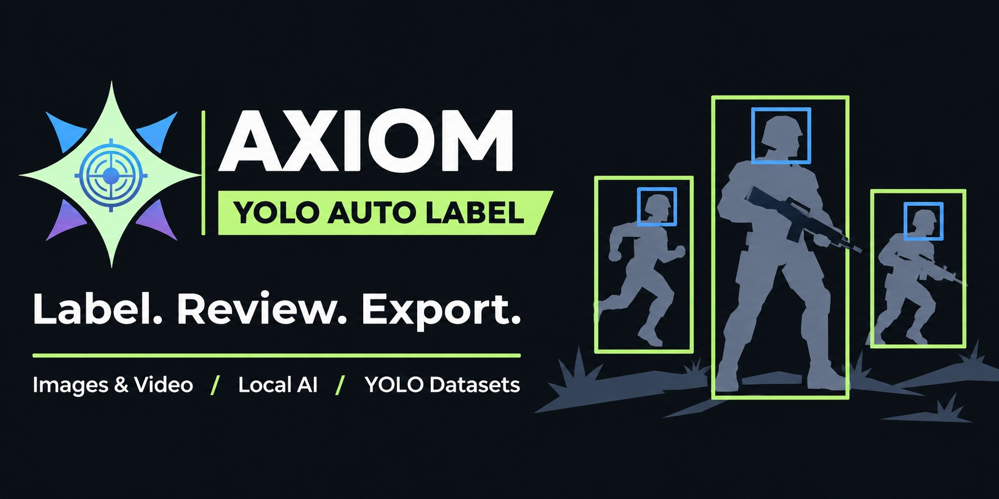

# Axiom YOLO Auto Label

**Turn game screenshots and video clips into reviewed, YOLO-ready datasets.**

Axiom is a local annotation workspace powered by [Tencent WeVisOne-VL](https://github.com/Tencent/WeVisOne-VL). Describe the characters you want to find, generate bounding boxes, refine them in a dark WebUI, and export a dataset for YOLO training.

Built for Windows, with **English** and **Traditional Chinese** interfaces. Annotation and training run on your computer; no hosted inference API is required.

**Video:** [Watch on YouTube](https://www.youtube.com/watch?v=GqlZqGUIoW0)

[Quick start](#quick-start) · [Hardware guidance](#hardware-guidance) · [Workflow](#workflow) · [Model settings](#model-settings) · [YOLO export](#yolo-export) · [Troubleshooting](#troubleshooting)

**Topics:** `yolo` · `auto-labeling` · `computer-vision` · `object-detection` · `wevisone-vl` · `pytorch` · `cuda` · `fp8` · `video-annotation`

## Features

- **Automatic bounding boxes** with WeVisOne-VL 2B or 4B, using Native, FP8 or Q4 precision.
- **Game-specific descriptions** with optional teammate/enemy distinction and separate head labels.
- **Manual review and editing** with drawing, resizing, undo/redo and automatic saves.
- **Images, folders and videos** through drag-and-drop, file selection or local paths.
- **Video frame sampling** with a preview, start/end times and a seconds-per-image interval.
- **Independent projects** with saved settings, annotations, and create/rename/delete controls.
- **Bulk image management** with rectangle selection, Ctrl+A and immediate removal from the dataset.
- **YOLO export and local training** with progress, loss, validation metrics and checkpoint downloads.

## Quick start

Install **Python 3.11** and, for GPU use, a compatible NVIDIA driver. Download or clone this repository, then open PowerShell in its root folder.

### Install

The following CUDA 12.6 stack matches the tested development environment:

```powershell
python -m venv .venv
.\.venv\Scripts\python.exe -m pip install --upgrade pip
.\.venv\Scripts\python.exe -m pip install torch==2.10.0 torchvision==0.25.0 --index-url https://download.pytorch.org/whl/cu126
.\Setup.bat
```

`Setup.bat` installs the remaining dependencies. When creating an environment itself, it uses `--system-site-packages`; creating `.venv` with the commands above keeps a fresh installation isolated.

For CPU-only annotation, run `Setup.bat` and select **Native** precision. CPU inference is substantially slower; **Q4 requires CUDA** in Axiom.

### Launch

```powershell
.\Start.bat
```

The WebUI opens at **http://127.0.0.1:7864**. Keep the terminal open while using the app. If another application occupies that port, the launcher chooses a free one. A second launch reopens an existing Axiom instance when available.

The first use of a model downloads its weights from Hugging Face. YOLO training may also download the selected pretrained checkpoint. Allow time and disk space for these downloads.

Create a project, add a few images, then open **Auto label**. Review the generated boxes before exporting. The top-bar language selector switches between **English** and **繁體中文** and remembers your choice.

## Hardware guidance

These are **planning estimates for automatic annotation**, not certified minimum configurations. Use **batch size 1**. Minimum estimates assume a **1M vision pixel budget**; recommendations assume **2M**.

| Configuration | Estimated minimum | Recommended starting point |
|---|---|---|
| **2B Q4** | GTX 1060 6GB | RTX 2060 SUPER 8GB or RTX 3050 8GB |
| **4B FP8** | RTX 2060 SUPER 8GB or RTX 3060 8GB, using the fallback path | RTX 4070 12GB or RTX 4060 Ti 16GB |

Development validation used an **RTX 4070 SUPER 12GB**. The 6GB/8GB minimum estimates have not been validated on those specific cards. Memory use depends on image dimensions, pixel budget, batch size, response length and other GPU applications. Higher model numbers alone do not guarantee enough VRAM.

**FP8 compatibility:** RTX 20/30-series GPUs use FP8 weight storage with dequantization for computation. Supported Ada-class GPUs, such as the RTX 40 series, can use Axiom's CUDA FP8 matrix path. An optional fused decode kernel reduces overhead when CUDA headers and runtime compilation are available; otherwise Axiom keeps the regular FP8 path. See NVIDIA's [FP8 hardware support matrix](https://nvidia.github.io/TransformerEngine/support_matrix.html).

**GTX 10-series compatibility:** use compatible CUDA 12.6 packages such as the stack above. The project's bitsandbytes version supports Pascal NF4 with its CUDA 11.8–12.6 Windows builds; its newer CUDA builds omit Pascal targets. See the [bitsandbytes installation matrix](https://huggingface.co/docs/bitsandbytes/v0.49.2/en/installation).

These estimates do not describe YOLO training requirements. Training model size, image size and batch size are separate controls.

## Workflow

1. **Create or open a project.** Each project keeps its own images, settings and annotations.
2. **Import media.** Drop files or folders, browse for them, or paste local paths.
3. **Describe the targets.** Set the game name, target description and optional team/head settings.
4. **Run Auto label.** Choose a model and precision under **Model & image size**. The footer shows progress and throughput; **Activity** shows diagnostics.
5. **Review the boxes.** Draw missing boxes, adjust existing ones, then use **Reviewed · Next** to save and advance. A reviewed empty image is an intentional negative example.
6. **Export YOLO.** Download a ZIP with images, labels and a training/validation split.
7. **Optionally train locally.** Open **Train**, choose the YOLO model and training settings, then download `best.pt` after completion.

Settings and annotations save automatically. **Only new images** skips existing automatic labels; disable it to rerun them. Manually reviewed images stay protected from automatic replacement. After an interrupted annotation run, completed labels remain saved.

### Target descriptions and classes

Use visible attributes such as clothing, outlines or team markers. For example:

> Player characters wearing blue uniforms with blue markers above their heads.

Full-body queries always run. Enabling head labels adds separate head queries; enabling team distinction creates separate teammate and enemy classes. With both team distinction and descriptions enabled, provide a description for each team.

| Distinguish teams | Label heads | Exported class order |
|---|---|---|
| Off | Off | `target` |
| Off | On | `target`, `target_head` |
| On | Off | `teammate`, `enemy` |
| On | On | `teammate`, `enemy`, `teammate_head`, `enemy_head` |

Each class uses its own query, so teams and heads increase inference time. The class layout locks after labeling starts; create a new project to change it. Predictions can miss small targets, confuse teams or include false positives. Review labels before training.

### Video import

Drop a video, choose **Add images → Choose video**, or enter its path. Select the clip range and **Seconds per image** before importing.

- Times accept minutes, `mm:ss` or `hh:mm:ss`, including fractional seconds.
- For example, `1:00` to `2:00`, sampled every `2` seconds, produces **30 images**.
- Sampling includes the start and stops before the end time.
- Completed frames are saved. Repeating an import reuses them without replacing existing labels.
- Multiple videos are configured one at a time.

Extraction uses bundled FFmpeg. A video may still be extractable when its codec prevents browser preview. Browser video uploads are limited to 32GB; use a local path for larger files. Each clip is limited to 50,000 sampled frames, with a minimum interval of 0.05 seconds.

### Supported media

**Images:** JPEG/JFIF, PNG, WebP, BMP, TIFF, GIF, AVIF, HEIC/HEIF, TGA, PPM/PGM/PBM and ICO. Animated or multipage files use the first frame; EXIF orientation is applied.

**Videos:** MP4, MKV, MOV, AVI, WebM, M4V, WMV, FLV, MPEG/TS, OGV and other supported containers, subject to FFmpeg's codec support.

Local paths reference source files in place; keep those files available. Browser uploads create managed copies. Imports and exports preserve original source files.

## Model settings

| Precision | Behavior |
|---|---|
| **Native** | BF16 on supported CUDA GPUs, FP16 on other CUDA GPUs, FP32 on CPU. |
| **FP8** | E4M3 decoder weights, with hardware FP8 matrix operations or a dequantization fallback depending on the GPU. |
| **Q4** | CUDA-only bitsandbytes NF4 with double quantization. |

The vision encoder and output projection stay native in quantized modes. FP8 and Q4 are produced from the official weights at load time. They reduce weight memory but do not guarantee faster inference. FP8 loading also uses host RAM while converting decoder layers individually.

New projects default to **2B Native**, **2M pixels**, **batch 1**, with image normalization **off**.

### Vision pixel budget

Choose **1M**, **2M**, **4M** or **8M** under **Performance & advanced**. These values limit total image pixels processed by the annotation model; they are not image widths. Older saved budgets below 1M are upgraded to 1M at startup.

For small or distant targets, keep normalization off and try a higher pixel budget. 4M/8M primarily help high-resolution originals; raising the cap cannot restore detail absent from the source. Higher budgets cost more time and VRAM. Automatic tiled inference is not currently implemented.

### Image normalization

| Option | Output canvas |
|---|---|
| **Off** | Original dimensions; the model's pixel budget still applies. |
| **1K** | 1024 × 1024 |
| **720p** | 1280 × 720 |
| **480p** | 854 × 480 |

Normalization preserves aspect ratio with padding and applies to annotation input and exported dataset images. The editor stores boxes in original-image coordinates and maps them during export.

## YOLO export

The dataset ZIP contains:

```text
images/
  train/
  val/
labels/
  train/
  val/
data.yaml
classes.txt
manifest.json
```

Each label line uses `class_id center_x center_y width height`, with coordinates normalized to `[0, 1]`.

Only **Auto labeled** and **Reviewed** images are exported; pending and failed images are excluded. An eligible empty image receives an empty label file. Review automatic empty results to avoid treating missed targets as background.

The split is reproducible for a fixed dataset and seed. Image names use unique IDs to avoid collisions. `data.yaml` uses relative paths so the dataset can be moved after extraction. Interface language changes do not alter class IDs.

### Optional YOLO training

Local training supports YOLO11n/s/m and YOLOv8n/s. At least two eligible images are required for separate training and validation sets. Axiom unloads the annotation model before starting a separate training worker.

The default is **YOLO11n, 640px, batch 8, 50 epochs**. CUDA and AMP are used when available. Training image size is independent of the annotation pixel budget: choosing 2M or 8M does not change YOLO's 640px setting.

Epoch progress, loss and validation mAP50 appear in **Train**. **Stop** is cooperative, allowing pending work and weight saving to finish. Starting another job creates a fresh training run from the selected pretrained model; it does not automatically resume a stopped checkpoint.

## Data and shortcuts

Projects, settings, annotations, imported media, exports and training runs are stored under `data/`. Back up this directory together with any externally referenced source files.

To use another storage location:

```powershell
$env:AXIOM_DATA_DIR = "D:\AxiomData"
.\Start.bat
```

Image removal is immediate and removes dataset entries and labels while keeping source files and managed upload copies. Project deletion uses a confirmation dialog and keeps original files and existing exports/checkpoints.

| Shortcut | Action |
|---|---|
| `B` / `V` | Draw / select boxes |
| `1`–`4` | Choose the active class |
| `Ctrl+Z` / `Ctrl+Y` | Undo / redo box edits |
| `Ctrl+S` | Save annotations |
| `←` / `→` | Previous / next image |
| `Space` + drag / mouse wheel | Pan / zoom |
| `Ctrl+A` in the gallery | Select all matching images, including other pages |
| `Backspace` / `Delete` | Remove selected images or canvas boxes, according to focus |
| `Escape` | Clear the current selection |

Drag a rectangle across thumbnails to select multiple images. Ctrl-click toggles individual images; Shift-click selects a page-local range. Text fields keep their normal editing shortcuts.

## Troubleshooting

| Symptom | What to check |
|---|---|
| CUDA is unavailable | Check the NVIDIA driver and that `.venv` has a CUDA-enabled PyTorch build compatible with the GPU. |
| Out of VRAM | Use batch 1, lower the pixel budget, or select 2B/Q4. Multi-image annotation batches retry at a smaller size after CUDA OOM. |
| FP8 is slow | Check the reported backend. Older GPUs use a weight-only fallback; Native or Q4 may be a better fit. |
| Small targets are missing | Use a sharper source, turn normalization off, increase the pixel budget and review missing boxes manually. |
| Output token limit reached | Raise **Max output tokens** and retry; incomplete coordinate output is rejected. |
| A stopped run takes time to exit | Downloads, generation and training stop cooperatively rather than terminating immediately. |
| No browser video preview | Try extraction; FFmpeg supports codecs that the browser may not preview. |

## Development

```text
axiom/             API, storage, annotation runtime, exports and training
web/               Static WebUI and assets
tests/             API, geometry, export, video and FP8 math checks
launch.py          Local server launcher
Setup.bat          Dependency installer
Start.bat          Windows launcher
```

Run the checks with:

```powershell
.\.venv\Scripts\python.exe -m pip install pytest httpx
.\.venv\Scripts\python.exe -m pytest -q tests
```

For an explicit port without opening the browser:

```powershell
.\.venv\Scripts\python.exe launch.py --port 7864 --no-browser
```

The server binds to loopback. `--no-browser` suppresses browser opening; it does not hide the terminal. See [VALIDATION.md](VALIDATION.md) for local functional checks, performance measurements and their limits.

## License

Axiom source code is licensed under the **[Apache License 2.0](LICENSE)**. See [NOTICE](NOTICE) for attribution.

Third-party libraries, model weights and artwork retain their respective licenses and rights. In particular, the Ultralytics dependency has its own [AGPL-3.0 license](https://github.com/ultralytics/ultralytics/blob/v8.3.228/LICENSE); Axiom's license does not relicense that dependency or its model weights.

## Acknowledgments

- [Tencent WeVisOne-VL](https://github.com/Tencent/WeVisOne-VL) — models, detection prompts and coordinate-token conventions; [2B weights](https://huggingface.co/tencent/WeVisOne-VL-2B), [4B weights](https://huggingface.co/tencent/WeVisOne-VL-4B), [upstream license](https://github.com/Tencent/WeVisOne-VL/blob/main/LICENSE).
- [PyTorch](https://pytorch.org/) and [Transformers](https://github.com/huggingface/transformers) — model inference.
- [bitsandbytes](https://github.com/bitsandbytes-foundation/bitsandbytes) — NF4 quantization.
- [Ultralytics](https://github.com/ultralytics/ultralytics) — YOLO training; see its [upstream license](https://github.com/ultralytics/ultralytics/blob/v8.3.228/LICENSE).
- [FFmpeg](https://ffmpeg.org/) and [imageio-ffmpeg](https://github.com/imageio/imageio-ffmpeg) — video frame extraction.

Model weights, dependencies and artwork retain their respective owners' rights and license terms.
