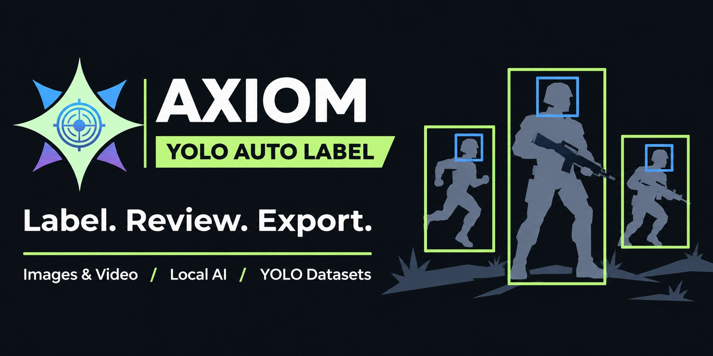

# Axiom publication assets

## Repository description

Local AI-assisted annotation for game screenshots and videos. WeVisOne-VL 2B/4B, manual review, YOLO export and training.

## Topics

`yolo` `auto-labeling` `annotation-tool` `computer-vision` `object-detection` `dataset` `wevisone-vl` `vision-language-model` `pytorch` `cuda` `fp8` `quantization` `video-annotation` `webui` `windows`

## Cover

The cover is a product illustration, not a screenshot. It was generated with the built-in image generation tool using the existing Axiom logo as a brand reference.

Design brief: a wide 2:1 dark-charcoal GitHub cover with mint/blue/purple branding, generic game-like character silhouettes with body/head bounding boxes, and the exact text “AXIOM”, “YOLO AUTO LABEL”, “Label. Review. Export.” and “Images & Video / Local AI / YOLO Datasets”. No benchmark or accuracy claims.

## Video

[Watch on YouTube](https://www.youtube.com/watch?v=GqlZqGUIoW0)
